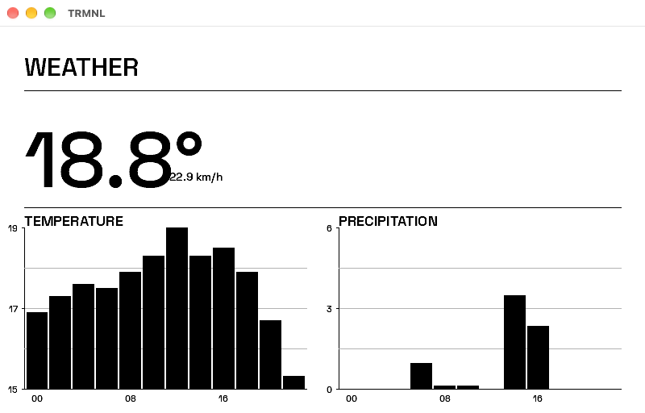

# TRMNL.Bar

Show TRMNL screens in [Metrix.Bar](https://metrix.bar/). Connect a virtual device to an official or self-hosted TRMNL server, or mirror the current screen of a device you already use. Manage Recipes and playlists on your TRMNL server.

[简体中文](README.zh-CN.md)

## Install

Download [TRMNL.bar](dist/TRMNL.bar?raw=1), then choose **Import .bar…** in Metrix.Bar 0.3.2 or later and select the file. Dashboard settings and menu bar actions use English by default and support Simplified Chinese. Restart Metrix.Bar after changing its language to update the dashboard’s menu. Metrix.Bar needs access to `esm.sh` to load the dashboard’s runtime libraries when they are absent from its cache.

## Connect

Set **Server URL** to your TRMNL server. It defaults to `https://trmnl.com`. Use the base URL, including any deployment prefix, such as `https://example.com/trmnl/`.

- **Device** follows the server’s playlist. Leave **Device ID** blank to generate a stable virtual ID, or enter an ID already registered with your server. Leave **Device token** blank for automatic pairing. If your server requires registration, right-click the TRMNL menu bar item to find the device ID and any pairing code. On trmnl.com, follow the device registration and BYOD requirements for your account.
- **Mirror** shows an existing device’s current screen while its playlist continues independently. Enter that device’s **Device API Key** in **Device token**. Set **Mirror refresh interval (seconds)** if you want a different interval from the default 300 seconds. The range is 10–86,400 seconds.

When screens come from a separate CDN, enter its address in **Image server URL** and approve that origin in Metrix.Bar. To customize the tray, set **Menu bar icon** to an Iconify name such as `mdi:monitor`, an emoji, or short text.

## Refresh and reconnect

Right-click the TRMNL menu bar item to view connection status, open dashboard settings, or manage the connection. The panel and desktop widget show the TRMNL screen when available.

- **Refresh** retries any unfinished download first. The last successful screen stays visible if a download fails.
- If the token expires, enter a new Device API Key to resume automatic refresh. You can also try a manual refresh.
- **Disconnect** clears the screen and deletes its token and recovery checkpoint. The dashboard stays disconnected across restarts. Select **Connect** to resume and supply a fresh token if your server or mode requires one.

## Development

Run `pnpm install`, `pnpm check`, `pnpm test`, and `pnpm build` in this directory. The build writes `dist/TRMNL.bar`.

## License

[Apache License 2.0](LICENSE).
