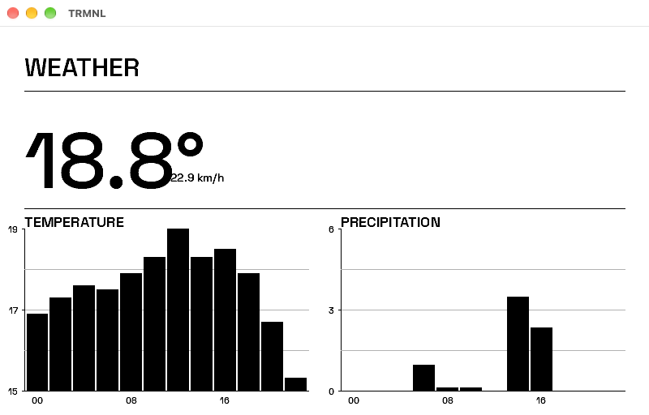

# TRMNL.Bar

在 [Metrix.Bar](https://metrix.bar/) 中查看 TRMNL 画面。可作为虚拟设备接入官方或自托管服务端，也可镜像已有设备的当前画面。Recipes 和播放列表在 TRMNL 服务端管理。

[English](README.md)

## 安装

下载 [TRMNL.bar](dist/TRMNL.bar?raw=1)，在 Metrix.Bar 0.3.2 或更新版本中选择「导入 .bar…」，打开下载的文件。看板设置和菜单栏操作默认使用英语，支持简体中文。更改 Metrix.Bar 的语言后，重启应用即可更新看板菜单。

## 连接

「服务端地址」默认为 `https://trmnl.com`。使用自托管服务时填写基础地址，可含部署路径前缀，例如 `https://example.com/trmnl/`。

- **设备**模式按服务端的播放列表轮播。「设备 ID」可留空生成稳定的虚拟 ID，也可填已登记的 ID。「设备令牌」留空会自动配对。需要登记时，右键点击菜单栏中的 TRMNL 图标，查看设备 ID 和服务端提供的配对码。连接 trmnl.com 时，按账号提示完成设备登记并满足 BYOD 要求。
- **镜像**模式跟随已有设备的当前画面，不推进它的播放列表。在「设备令牌」填入该设备的 **Device API Key**。「镜像刷新间隔」默认 300 秒，可设为 10–86,400 秒。

画面使用独立 CDN 时，填写「图片服务地址」并在 Metrix.Bar 中授权该来源。「菜单栏图标」支持 Iconify 名称（如 `mdi:monitor`）、表情或短文本。

## 刷新与重连

右键点击菜单栏中的 TRMNL 图标，可查看连接状态、打开看板设置或管理连接。面板和桌面小组件在获取画面后显示 TRMNL 内容。

- 「刷新」优先重试未完成的下载。下载失败时保留上一张成功显示的画面。
- 令牌失效时，填入新的 Device API Key 可恢复自动刷新，也可手动刷新重试。
- 「断开连接」会清除画面、设备令牌和恢复检查点，重启后仍保持断开。点「连接」恢复，按所选模式和服务端要求填写新令牌。

## 许可证

[Apache License 2.0](LICENSE)。
